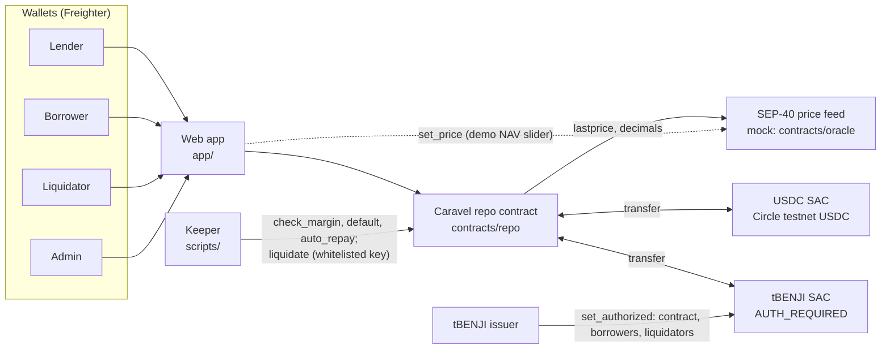
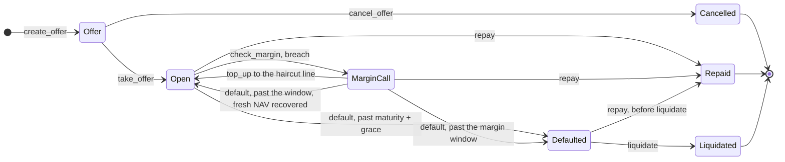

<p align="center"></p>

# Caravel

**On-chain term repo for tokenized Treasuries on Stellar.**
Fixed-term, fixed-rate USDC loans against tokenized money-market funds, priced off daily NAV, settled with atomic DvP.

> DeFi tries to liquidate Treasuries at 3 a.m. on a Sunday. TradFi never does that. It does repo.

Built at HackMeridian 2026 (Lisbon, 25–26 Oct) · Genesis category · Stellar Unlocked + Stellar Composed.

Live: [landing](https://caravel-repo.pages.dev/) · [app on testnet](https://caravel-repo.pages.dev/app/) · Five-minute intro: [INTRO.md](INTRO.md) · Design rulings: [DECISIONS.md](DECISIONS.md) · Mechanics spec: [docs/mechanics.md](docs/mechanics.md) · Collateral research: [docs/collateral-research.md](docs/collateral-research.md) · Design system: [design/](design/README.md) · App: [app/](app/README.md) · Scripts and keeper: [scripts/](scripts/README.md)

## Problem

Stellar holds billions in tokenized fund shares that no on-chain lender can hold.

| Fact | Value | Source |
|---|---|---|
| RWAs on Stellar (DefiLlama Active AUM) | **$3.03B** | [DefiLlama RWA](https://defillama.com/rwa/chain/stellar) |
| Of which working in DeFi (DefiLlama DeFi Active TVL) | **$133K** | [DefiLlama RWA](https://defillama.com/rwa/chain/stellar) |
| Spiko on Stellar, the largest issuer (9 funds) | **$1.97B** | [DefiLlama RWA](https://defillama.com/rwa/chain/stellar) |
| Franklin BENJI on Stellar ($434.7M, [DefiLlama](https://defillama.com/rwa/asset/BENJI)) held by any smart contract | **0 contracts** | [Horizon](https://horizon.stellar.org/assets?asset_code=BENJI&asset_issuer=GBHNGLLIE3KWGKCHIKMHJ5HVZHYIK7WTBE4QF5PLAKL4CJGSEU7HZIW5) |
| Spiko markets on Stellar lenders | XOXNO lists six, all disabled | [WhaleHub](https://whalehub.io/blog/spiko-stellar) |
| Largest Stellar lender (Blend V2) | $132M, mostly XLM collateral, no allowlist hook | [gap analysis](docs/research/rwa-collateral-gap-analysis.md) |
| Closest Stellar peers | XOXNO Spiko spoke (disabled) · Liqvid X on Alula (SCF #45): open-ended pool, oracle NAV, liquidated at HF<1 | [WhaleHub](https://whalehub.io/blog/spiko-stellar) · [SCF #45](https://communityfund.stellar.org/submissions/recLauVL3boo779AG) |

DefiLlama figures as of 25 Oct 2026. The per-asset breakdown and superseded figures are in [docs/numbers.md](docs/numbers.md).

A holder of tokenized T-bills who needs dollars for a week has two options today: sell the fund shares and lose the yield, or leave Stellar. The assets are some of the safest on the network, and almost none of them can be borrowed against.

## Insight

The asset is safe; the exit is slow. A tokenized Treasury fund share has a price once a day, turns into cash only on business days, and can be held only by holders the issuer approves ([collateral research §1](docs/collateral-research.md#1-the-lens-every-dollar-token-ends-in-t-bills-and-the-weak-link-is-exit-not-the-asset)).

24/7 DeFi lending fails on all three counts. Between NAV prints there is no new price to react to. A seized share can't be redeemed until the next business day. A permissionless liquidation bot can't even receive the token, because the issuer's AUTH_REQUIRED flag stops it.

Money markets already have a model for this asset: the **repo**. Caravel runs it as an open market on-chain. Debt is fixed up front, margin is checked against daily NAV, the borrower gets a window to post more collateral before default, and a default goes to issuer-approved liquidators at NAV minus a fixed discount.

Repo itself already has a precedent on Stellar: Ascend × M1X ran a bilateral institutional repo on one sovereign-bond token (USDM1), rolled hourly ([stellar.org press, 23 Oct 2026](docs/numbers.md#precedent-and-peers-checked-26-oct)). Caravel is the open order book for the same trade: any USDC lender, collateral from several issuers' permissioned funds, margin on daily NAV, and liquidation only to issuer-approved buyers.

One design fact carries most of the compliance weight: **lenders deal only in USDC.** They put in USDC and get USDC back, except in the NAV-outage fallback of [DECISIONS #38](DECISIONS.md), where a Defaulted repo's collateral goes to the lender or to an issuer-approved custody account the lender names. Otherwise only the contract, borrowers and liquidators need the issuer's approval, the same split [Aave Horizon](https://aave.com/docs/aave-v3/horizon) uses.

## How it works

One repo, end to end: 1,000 USDC for 7 days at 5% APR against tBENJI at NAV 1.00, with a 3% haircut, a 2% margin trigger, a 1% liquidation discount and a 10% protocol fee on interest. Amounts are rounded to cents; exact 7-decimal values are in [docs/mechanics.md §6](docs/mechanics.md#6-worked-example) and in the contract tests.

1. **Offer.** The lender posts the offer and the 1,000 USDC moves into the contract right away. Until someone takes it, the lender can cancel and get it back.
2. **Take (DvP).** The borrower takes the whole offer. In one transaction the contract pulls **1,031.92 tBENJI** from the borrower and pays out **1,000 USDC**. Debt is fixed at **1,000.96 USDC** (principal + full-term interest). Either both legs settle or neither does. The contract computes the collateral itself, and the borrower's signature pins the exact amount, so a NAV move between preview and submit fails the transaction instead of overcharging.
3. **Margin.** Anyone (in practice our keeper) can call `check_margin` against a fresh NAV. If NAV falls about 1% (below roughly 0.9898, the 2% trigger), the repo goes into **MarginCall** and the borrower has a window to add collateral back to the 3% haircut line. At NAV 0.985 that is 15.71 more tBENJI.
4. **Repay.** At or before maturity the borrower pays 1,000.96 USDC and gets all collateral back. The lender receives **1,000.86** (4.50% net APR) and the protocol fee is **0.10**. Repaying early costs the same: the debt is fixed at take. With **auto-repay** on (the app's default), the same signature that takes the offer lets the contract pull the 1,000.96 USDC at maturity, so a borrower who forgets to press Repay still gets the collateral back as long as the USDC is in the wallet.
5. **Default.** If the borrower hasn't repaid by maturity plus grace, or misses the margin deadline, anyone can mark the repo **Defaulted**. No price is needed for this step. For an auto-repay repo, `default` first tries to pull the debt and settles as Repaid if it can; only a borrower who is short of USDC defaults. Until a liquidator buys, the borrower can still repay the same 1,000.96 USDC and get all the collateral back.
6. **Liquidation.** A whitelisted, issuer-approved liquidator buys all the collateral at NAV − 1%: **1,021.60 USDC** at NAV 1.00. The proceeds pay the lender's terms first, then the fee, then the surplus to the borrower (**20.64**). If proceeds fall short of the lender's terms, the lender takes everything and a `Shortfall` event records the gap on-chain.

In the demo, **1 day = 60 seconds**, so the 7-day repo matures in 7 minutes. That is configuration only: interest uses a 365-day year of the configured day length, so the demo accrues the same coupon as a real 7-day repo.

## FAQ

- **Why borrow at 5% against a fund yielding 3.87% (USDXX 7-day, a US T-bill proxy)?** For a passive holder the carry is negative, about 1.13% a year against redeeming, and known up front. The borrower is a treasury bridging a cash gap without redeeming, or a desk whose USDC earns more than the loan costs ([Risks: Carry](#risks-and-limits)).
- **Who liquidates?** Issuer-approved accounts the admin whitelists. On testnet that is one team wallet, driven by the keeper; at launch, a market maker that can redeem with the issuer. Nothing obliges one to buy, so a Defaulted repo can wait. If the NAV feed itself dies, nobody liquidates (a stale NAV blocks `liquidate`); after `max_nav_age` + 7 days the lender may instead take the collateral in kind, to its own approved wallet or a custody account (DECISIONS #38).
- **What if the issuer freezes or pauses the token?** Repay, top-up and liquidation of that asset stop until it lifts, and the haircut does not cover that. The guardian can switch on `no_seize` at once, so no borrower is defaulted for the issuer's action meanwhile.
- **Who gets the fund's dividends?** Real BENJI pays its yield in new tokens to the holder of record, which during a repo is the contract. Passing it back to the borrower is on the roadmap; the demo tokens pay none.
- **Is the price feed live?** No. The contract reads a mock SEP-40 feed so the demo can move the NAV on camera; `npm run feeds` reads a live Reflector feed through the same interface. The feed is any SEP-40 feed, chosen at deploy (RedStone already publishes BENJI NAV on Stellar; Chainlink, live since 14 Oct, is not SEP-40); a deployed contract keeps its feed, so changing it means a new deployment. The USDC is real Circle testnet USDC.

## Architecture



- **Repo contract** ([contracts/repo](contracts/repo/src/lib.rs)): holds offers, escrow and collateral; runs every flow. All arithmetic lives in one module, [math.rs](contracts/repo/src/math.rs), with its own tests. NAV is read only through [oracle.rs](contracts/repo/src/oracle.rs), which enforces the staleness rule and the NAV sanity band.
- **Token contracts (SAC):** USDC and tBENJI are classic Stellar assets. The contract moves them through their Stellar Asset Contracts, so balances stay visible in any Stellar wallet.
- **Price feed:** a mock of the SEP-40 interface Reflector uses (same `Asset` and `PriceData` shapes, 14 decimals). Any SEP-40 feed, chosen at deploy (RedStone already publishes BENJI NAV on Stellar; Chainlink, live since 14 Oct, is not SEP-40): a deploy parameter, not a code change, but a deployed contract cannot switch feeds.
- **Keeper** ([scripts/keeper](scripts/keeper/src/keeper.ts)): an off-chain script that calls `check_margin` on open repos, `auto_repay` or `default` once a deadline passes, and then `liquidate` on every Defaulted repo. The first three are permissionless, so anyone can run them. `liquidate` is signed with the whitelisted, issuer-approved liquidator key; on testnet the keeper is the only liquidator.
- **Web app:** lender, borrower, liquidator and admin views on testnet, built on generated TypeScript bindings.
- **Issuer:** authorizes the repo contract, each borrower and each liquidator on tBENJI, plus, for the #38 NAV-outage fallback, the lender or one custody account per lender. This is the compliance layer; Caravel does no KYC of its own.

## Contract spec

### States



1. `take_offer` (borrower): offer → **Open**. Collateral in, USDC out in one atomic transaction. The offer is gone after this.
2. `check_margin` (anyone): Open → **MarginCall** when `debt > collateral × NAV × (1 − margin trigger)`, the asset's `margin_trigger_bps` (2% for tBENJI). Starts the margin window. Blocked on stale or out-of-band NAV.
3. `top_up` (borrower): MarginCall → **Open**, only once collateral is back at the initial haircut. Works with stale or out-of-band NAV, but an out-of-band NAV never clears the call.
4. `repay` (borrower): Open, MarginCall or Defaulted → **Repaid** (final), at the same fixed debt. Works with stale NAV, after maturity and after `default`, until a liquidation lands.
5. `default` (anyone): Open past maturity + grace, or MarginCall past the window → **Defaulted**. A missed margin call first re-checks the breach at a fresh in-band NAV: if the loan is back above the trigger, the call clears and the repo is **Open** again (#20); a stale or out-of-band NAV cannot clear it, and cannot default it either: `default` returns `StaleNav` / `NavOutOfBand` and waits for a fresh in-band NAV that confirms the breach. A maturity default needs no NAV. Then `liquidate` (whitelisted, fresh in-band NAV): Defaulted → **Liquidated** (final). Whichever of `repay` and `liquidate` lands first settles the repo; the other fails with `InvalidStatus`.

### Methods

| Method | Caller | Status change | Fresh, in-band NAV | Funds moved |
|---|---|---|---|---|
| `create_offer(lender, collateral_asset, principal, apr_bps, term_secs) → offer_id` | lender | → offer | no | lender USDC → contract |
| `cancel_offer(offer_id)` | the offer's lender | offer removed | no | contract USDC → lender |
| `take_offer(borrower, offer_id, auto_repay) → repo_id` | borrower | offer → Open | **yes** | borrower collateral → contract; contract USDC → borrower; with `auto_repay`, a USDC allowance for the debt |
| `repay(repo_id)` | borrower | Open / MarginCall / Defaulted → Repaid | no | borrower USDC → contract → lender (`P + I − fee`) and treasury (`fee`), a failed payout parked for `claim`; collateral → borrower |
| `set_auto_repay(repo_id, enabled)` | borrower | — | no | USDC allowance for the debt granted / withdrawn |
| `auto_repay(repo_id)` | anyone, from maturity or a missed margin deadline | Open / MarginCall → Repaid | no | as `repay`, pulled from the allowance; fails with `AutoRepayFailed` and moves nothing if the borrower is short or cannot receive the collateral |
| `top_up(repo_id, amount)` | borrower | MarginCall → Open at the haircut line | no | borrower collateral → contract |
| `check_margin(repo_id) → Status` | anyone | Open → MarginCall on breach; deadline set once | **yes** | none |
| `default(repo_id) → Status` | anyone | Open / MarginCall → Defaulted, or → Repaid for an auto-repay repo whose debt it can pull; a missed MarginCall → Open when a fresh NAV shows it recovered (#20) | maturity: no; missed MarginCall: yes (clears or confirms the breach, else `StaleNav` / `NavOutOfBand`) | none, or as `auto_repay` |
| `liquidate(liquidator, repo_id)` | whitelisted liquidator | Defaulted → Liquidated | **yes** | liquidator USDC → contract → lender, treasury, borrower, a failed payout parked for `claim`; collateral → liquidator |
| `claim(who) → amount` | anyone with a parked payout | — | no | contract USDC → `who` (its whole parked balance; `NothingToClaim` if none) |
| `set_asset(asset, config)` | admin | — | — | — (sets haircut, staleness, NAV band and exposure cap; DECISIONS #13, #31, #32). Instant for a first listing or a change that only tightens; a loosening fails with `Loosens` (DECISIONS #33) |
| `set_liquidator(who, allowed)` | admin | — | — | — (removal instant, `LiquidatorSet` event; adding fails with `Loosens` unless already whitelisted, Raven R6) |
| `propose_liquidator(who) → eta`, `execute_liquidator(who)` | admin; execute from `eta` until `eta + timelock_secs` | — | — | — (the only way to add a liquidator; `LiquidatorProposed`, then `LiquidatorSet`) |
| `cancel_liquidator(caller, who)` | admin any time; guardian once per address (`VetoSpent` on a re-proposal it already cancelled) | — | — | — |
| `transfer_admin(new_admin, live_until_ledger)`, `accept_admin()` | admin starts (`live_until_ledger` 0 cancels); the new admin accepts by that ledger | — | — | — (two-step handover, pending entry in temporary storage; `AdminTransferStarted`, `AdminSet`) |
| `propose_guardian(guardian) → eta`, `execute_guardian()`, `cancel_guardian()` | admin only; execute in the `execute_asset` window | — | — | — (guardian rotation behind the timelock; the guardian cannot cancel it; `GuardianChangeProposed`, `GuardianSet`) |
| `set_pause(asset, Pause { no_new_repos, no_seize })` | admin | — | — | — (instant for switching on; clearing fails with `Loosens`) |
| `guardian_set_asset(asset, config)`, `guardian_set_pause(asset, pause)` | guardian | — | — | — (tighten only, instant: disable, raise haircut, lower cap or NAV age, narrow the NAV band, switch a pause on) |
| `propose_asset(asset, config) → eta`, `propose_pause(asset, pause) → eta` | admin | — | — | — (queues any change, loosening included, for `timelock_secs`) |
| `execute_asset(asset)`, `execute_pause(asset)` | admin, from `eta` until `eta + timelock_secs` (`ProposalExpired` after) | — | — | — |
| `cancel_asset(caller, asset)`, `cancel_pause(caller, asset)` | admin any time; guardian once per change (`VetoSpent` when the admin re-proposes the change it cancelled) | — | — | — |
| `config()`, `offer(id)`, `repo(id)`, `asset(addr)`, `pause(addr)`, `open_debt(addr)`, `pending_asset(addr)`, `pending_pause(addr)`, `pending_liquidator(who)`, `roles()`, `is_liquidator(who)`, `claimable(who)` | anyone | read only | — | — |

Every state-changing call checks status first and fails with a named error otherwise. An offer can be taken once; a repo can be repaid, defaulted or liquidated once.

### Events

| Event | Topics | Data |
|---|---|---|
| `AssetConfigured` | asset | haircut_bps, margin_trigger_bps, enabled, max_nav_age_secs, max_nav_move_bps, nav_floor, nav_ceiling, max_open_debt, band_settle_secs |
| `NavLevelNoted` | oracle_asset | price, since (`note_nav` started the band settle clock on a new NAV level) |
| `PauseSet` | asset | no_new_repos, no_seize |
| `AssetChangeProposed` | asset | eta, haircut_bps, margin_trigger_bps, enabled, max_nav_age_secs, max_nav_move_bps, nav_floor, nav_ceiling, max_open_debt, band_settle_secs |
| `PauseChangeProposed` | asset | eta, no_new_repos, no_seize |
| `ProposalExecuted` | asset, kind (`asset` / `pause`) | — (followed by `AssetConfigured` / `PauseSet`) |
| `ProposalCancelled` | asset, kind | by (cancelled, replaced by a new proposal, or superseded by an instant change) |
| `OfferCreated` | offer_id, lender | collateral_asset, principal, apr_bps, term_secs |
| `OfferCancelled` | offer_id, lender | principal |
| `RepoOpened` | repo_id, offer_id | lender, borrower, collateral_asset, collateral_amount, principal, interest, haircut_bps, maturity_ts |
| `MarginCall` | repo_id | deadline |
| `MarginCleared` | repo_id | — (`default` cleared a missed call on a recovered NAV, #20) |
| `ToppedUp` | repo_id | amount, collateral_amount, cleared |
| `Repaid` | repo_id | lender_amount, fee |
| `Defaulted` | repo_id | — |
| `Liquidated` | repo_id, liquidator | proceeds, lender_amount, fee, borrower_amount |
| `Shortfall` | repo_id | amount the lender is still owed |
| `PayoutParked` | repo_id, to | amount (a USDC payout to `to` failed, e.g. frozen account; kept for `claim`) |
| `Claimed` | who | amount |

### Units and rounding

USDC amounts are `i128` in 7-decimal Stellar units; collateral amounts are in the token's own units (tBENJI 7 decimals, tSAFO 5, like Spiko's mainnet tokens). NAV is scaled by the feed's `decimals()`, read on every call, with the token's `decimals()` folded in so the math always lands in USDC units (DECISIONS #28). Every rounding goes the lender's way: interest and required collateral round up, collateral value rounds down, liquidation proceeds round up, and the fee rounds down so the lender keeps the dust.

### Rules the tests hold

- **The lender never gets more than the offer terms**, and on repay gets exactly `principal + interest − fee`.
- **No one-legged settlement.** USDC leaves escrow only in the same transaction the collateral arrives.
- **Debt is fixed at take.** Early repay pays the same amount.
- **The haircut is snapshotted at take.** Re-tiering an asset changes new takes only.
- **No action on an old price.** `take_offer`, `check_margin` and `liquidate` fail on stale NAV, judged against each asset's own `max_nav_age_secs`; `repay` and `top_up` never need a fresh price, so a borrower can always exit.
- **No action on an implausible price.** The same three calls fail with `NavOutOfBand` when the latest NAV is more than the asset's `max_nav_move_bps` from any of the feed's last 20 records, or outside its optional `nav_floor` / `nav_ceiling` (DECISIONS #31). Re-posting a bad price doesn't hide the jump. `repay` and `top_up` still work. A real move past the band is accepted once its level has stood `band_settle_secs` of ledger time, timed by the repo from the first permissionless `note_nav` that saw it (the keeper calls it each tick), never by feed timestamps; floor and ceiling still apply.
- **A disabled asset stops new offers and takes, not live repos.** Repay and liquidation still work.
- **Pause switches stop one action each, never an exit** (DECISIONS #30). `no_new_repos` blocks offers and takes; `no_seize` blocks `default` and `liquidate`, with the clock still running so seizure goes as soon as it clears. `repay` and `top_up` work under both.
- **A frozen account never traps the other side.** Every USDC payout from a settlement (lender, treasury, borrower surplus) is tried and, if the recipient cannot receive it (Circle freeze, closed trustline), parked in the contract for that recipient's `claim`; the repay, auto-repay or liquidation still lands. Collateral payouts stay direct (DECISIONS #24): an auto-repay that cannot return the collateral refunds the USDC and the repo defaults instead.
- **Exposure is capped per asset** (DECISIONS #32). `take_offer` fails with `CapExceeded` once the asset's open debt would pass `max_open_debt` (exactly at the cap passes); repay, auto-repay and liquidation (shortfall included) free the debt and are never blocked, even after the cap is cut below what is open.
- **Risk goes up only through a timelock** (DECISIONS #33). The guardian can only tighten, instantly; every loosening, a wider NAV band included, is `propose_*`, then `execute_*` from `eta` until `eta + timelock_secs` (then it expires), and admin or guardian can `cancel_*` it any time. An instant tightening drops a pending proposal, so it cannot be undone by a change queued earlier.

`cargo test --workspace` runs 281 tests (15 oracle, 256 repo, 10 Spiko-style token), including the three liquidation outcomes (surplus, lender made whole, shortfall) checked to the stroop, the NAV sanity band (a jump up or down blocks take, margin check and liquidation even after nav-keeper re-posts; repay and top-up still work), the exposure cap, the guardian and timelock (every loosening fails on every instant entry point and for the guardian), and the full flow on a Spiko-style token (`test_spiko.rs`): take without `approve`, repay, top-up, default and liquidate, plus rejections for a borrower, liquidator or repo contract off the issuer's allowlist and for a paused token.

### Parameters

All durations are configuration, so the demo compresses time without touching contract logic.

| Parameter | Scope | Demo | Production intent |
|---|---|---|---|
| `day_secs` | global | 60 | 86,400 |
| `term_secs` | per offer | 420 (7 demo days) | lender's choice, 7–30 days |
| `apr_bps` | per offer | 500 | lender's choice; quoted as a spread over T-bills (3.87%) |
| `haircut_bps` | per asset | 300 (tBENJI), 3,000 (tSAFO, testnet only) | USTBL/BENJI/USDY 300, EUTBL 1,200, CETES 2,350; SAFO not enabled until due diligence ([DECISIONS #35](DECISIONS.md), why: [config-tuning.md](docs/config-tuning.md)) |
| `margin_trigger_bps` | per asset | 200 (tBENJI), 2,000 (tSAFO) | BENJI/USTBL/USDY 200, EUTBL 850, CETES 1,850: each covers the discount, the worst 7-day NAV or FX fall since 2006 and a 50 bps buffer; discount ≤ trigger < haircut, enforced by the contract ([DECISIONS #35](DECISIONS.md), [config-tuning.md](docs/config-tuning.md)) |
| `liquidation_discount_bps` | global | 100 | 100: a third of Aave Horizon's 3% bonus, inside Morpho's 0.6–1.06%; 3 days of fund carry cost the liquidator ~3 bps, the rest pays for capital and freeze risk. The contract keeps it at or below every margin trigger ([DECISIONS #35](DECISIONS.md), [config-tuning.md §4](docs/config-tuning.md#4-liquidation-discount-200--100-global)) |
| `margin_window_secs` | global | 120 (2 demo days) | 3 days, so a Friday call survives to Monday's NAV |
| `grace_secs` | global | 60 (1 demo day) | 1 day |
| `max_open_debt` | per asset | 100,000 USDC (tBENJI), 50,000 USDC (tSAFO) | BENJI/USTBL/USDY $2M, EUTBL $1M, CETES $0.5M, SAFO 0 ([DECISIONS #32](DECISIONS.md)) |
| `max_nav_age_secs` | per asset | 180 s (tBENJI, 3 demo days) | ~96 h (345,600 s) for a fund that prints NAV on business days only, so Friday's print covers a weekend with no Saturday/Sunday prints |
| `max_nav_move_bps` | per asset | 2,500 (tBENJI, tSAFO), so the Admin NAV slider still works | BENJI/USTBL/USDY 50, EUTBL 500, CETES 800: above the largest one-day move since 2006 ([DECISIONS #35](DECISIONS.md), [config-tuning.md](docs/config-tuning.md)) |
| `nav_floor` / `nav_ceiling` | per asset | unset | BENJI 0.90 / 1.10; others unset |
| `band_settle_secs` | per asset | 1,200 s (20 min; the 60 s feed's 20-record window rolls in 19 min anyway) | 86,400 (24 h): a real move past the band freezes margin calls and liquidation for a day, not 19 days on a daily NAV; the guardian gets that day to pause a bad push. Raising it is instant, lowering it is timelocked |
| `fee_bps` | global | 1,000 (10% of interest) | 1,000, the same as Aave Horizon's and XOXNO's reserve factor, half of Blend's and Templar's 20% ([config-tuning.md §5](docs/config-tuning.md#5-fee-1000-kept-10-of-interest)); a 0% launch promotion stays a go-to-market option. The fee goes to `treasury`, which production labels a **reserve** (the seed of the insurance fund on the roadmap); the demo uses the admin account |
| `timelock_secs` | global | 120 (2 demo days) | 172,800 (2 days), so lenders and borrowers see a loosening coming ([DECISIONS #33](DECISIONS.md)) |

Demo values are `scripts/deploy.sh` defaults; the live testnet contract ([deployments/testnet.json](deployments/testnet.json)) runs these values since the 26 Oct 2026 redeploy (discount 100, tBENJI trigger 200, tSAFO trigger 2,000). Production values for haircut, trigger, discount, NAV band and fee are decided in [DECISIONS #35](DECISIONS.md), with the data and competitor terms behind each in [docs/config-tuning.md](docs/config-tuning.md); the timers follow [docs/mechanics.md §7](docs/mechanics.md). One more production note, **storage lifetime**: on testnet every call keeps instance storage (config, asset settings, open debt, and with it the contract code) alive for about 6 days and each offer or repo for 30 days, because extending the code entry further costs ~240 testnet XLM a day. Production sets the instance bump to at least 30 days, the longest term. An entry that expires anyway is not lost: since protocol 23 an archived entry is restored automatically when a transaction touches it, for a restore fee.

## Stellar features used

- **Authorized trustlines (AUTH_REQUIRED, AUTH_REVOCABLE, AUTH_CLAWBACK_ENABLED).** tBENJI is issued like a real fund share. Our spike proved an issuer can authorize a *contract* as a holder with `set_authorized`, and that freezing it works ([spikes/auth](spikes/auth/README.md)). This is the compliance layer: the issuer, not Caravel, decides who may hold the collateral. The core only uses the SEP-41 token interface, so the issuer decides either way: with AUTH_REQUIRED trustlines (BENJI) or in its own token contract (e.g. Spiko), which a test-only allowlist token covers (DECISIONS.md #24).
- **Stellar Asset Contracts.** The repo contract moves classic USDC and tBENJI through their SACs. No wrapped tokens.
- **Custom permissioned tokens.** Collateral #2, tSAFO, is a Spiko-style Soroban token (`contracts/spiko-mock`): no trustlines, an issuer allowlist checked on every transfer, no `approve` / `transfer_from`, and an issuer pause. The repo contract moves it through the same token interface, and the borrower's signed `take_offer` covers the transfer, so no allowance is needed.
- **Atomic DvP through Soroban authorization.** The borrower signs one `take_offer` call; the nested tBENJI transfer is part of the same signed authorization, at the exact collateral amount. Both legs settle in one transaction or not at all.
- **SEP-40 price feeds.** The contract speaks the SEP-40 interface Reflector uses, so it runs on any SEP-40 feed, chosen at deploy: the mock for the demo, a live feed in production.
- **Real Circle testnet USDC**, not a mock token.
- **Contract events** for every flow, so the app and the keeper index history without extra storage.
- **Storage TTL management.** Config and asset settings live in instance storage; offers, repos and the liquidator list in persistent storage, with the TTL extended on every touch so a live repo is never archived mid-term.

The contract reads a mock feed so the demo can move the NAV on camera. `npm run feeds` ([scripts/README](scripts/README.md#npm-run-feeds-mock-nav-next-to-a-live-sep-40-feed-2)) reads the mock and a live Reflector testnet feed through the same two SEP-40 calls the contract makes; both have identical interface specs on-chain.

## Run it

Prerequisites: Rust with the `wasm32v1-none` target and the Stellar CLI 28.x.

```bash
rustup target add wasm32v1-none
```

Run the contract tests:

```bash
cargo test
```

Build the contract wasm:

```bash
stellar contract build
```

Deploy to testnet (oracle, tSAFO and repo contracts, collateral config, liquidator whitelist, issuer authorization; IDs written to `.env`, `deployments/testnet.json` and the table below). `.env` is committed on purpose: it holds testnet-only burner keys, and no mainnet key exists anywhere in this repo.

```bash
scripts/deploy.sh
```

Keeper, NAV setter and demo seed (Node 20+; details in [scripts/README.md](scripts/README.md)):

```bash
cd scripts/keeper && npm ci
npm run keeper -- --refresh-nav   # check_margin / auto_repay / default / liquidate every 10 s; re-posts NAV before it goes stale
npm run set-nav -- 0.97           # push a tBENJI NAV (oracle admin)
npm run seed -- --reset           # deploy.sh --fresh, then open offers (tBENJI, tSAFO) and one taken repo
npm run repos                     # every repo with status, maturity and debt
```

Web app ([app/README.md](app/README.md)):

```bash
cd app && npm ci                  # also builds the bindings in packages/
VITE_DEMO_SIGNER=1 npm run dev    # http://localhost:5173, with the demo wallets
npm run build:public              # production build, demo signer off, secrets check
```

## Testnet deployment

<!-- testnet-ids:start: written by scripts/readme-ids.py from deployments/testnet.json; edits here are overwritten -->
| Contract | ID |
|---|---|
| Repo (Caravel) | [`CBWTB23F5PQTGX2QYOA3FJB3M6ZHDRCTT33XFKHXFD5SJJFTJEA7YTD6`](https://stellar.expert/explorer/testnet/contract/CBWTB23F5PQTGX2QYOA3FJB3M6ZHDRCTT33XFKHXFD5SJJFTJEA7YTD6) |
| Price feed (mock SEP-40) | [`CAOZIVOF5PVCIEFFZJ7FYFFJTUZ56HH5B2UIFSIWAQF4AR7BOMC5GMHR`](https://stellar.expert/explorer/testnet/contract/CAOZIVOF5PVCIEFFZJ7FYFFJTUZ56HH5B2UIFSIWAQF4AR7BOMC5GMHR) |
| USDC SAC (Circle testnet USDC) | [`CBIELTK6YBZJU5UP2WWQEUCYKLPU6AUNZ2BQ4WWFEIE3USCIHMXQDAMA`](https://stellar.expert/explorer/testnet/contract/CBIELTK6YBZJU5UP2WWQEUCYKLPU6AUNZ2BQ4WWFEIE3USCIHMXQDAMA) |
| tBENJI SAC (AUTH_REQUIRED) | [`CBC7SGLXRLNFXK5S33XL7PQ2YBT3NMT5W5EOW5PLOMLIIGBNGACKXBXX`](https://stellar.expert/explorer/testnet/contract/CBC7SGLXRLNFXK5S33XL7PQ2YBT3NMT5W5EOW5PLOMLIIGBNGACKXBXX) |
| tSAFO (Spiko-style mock, 5 decimals) | [`CBZOHBJ6CSLXD4HTW5KCYU5KLE7O3ZLYAZDLPUKOOUCZ6IV6FQKJKOU2`](https://stellar.expert/explorer/testnet/contract/CBZOHBJ6CSLXD4HTW5KCYU5KLE7O3ZLYAZDLPUKOOUCZ6IV6FQKJKOU2) |

Deployed 2026-10-26T08:27:35Z. The app and the keeper read the same ids from [deployments/testnet.json](deployments/testnet.json) and `.env`.
<!-- testnet-ids:end -->

## Risks and limits

- **Shortfall.** The margin call fires at a 1% NAV fall at maximum LTV (NAV 0.9898, 2% trigger), where a liquidation still raises 1.02% more than the debt; the lender is only touched past a 2% fall (NAV 0.9798). If NAV keeps falling during the margin window and the borrower doesn't top up, the lender takes the loss. At NAV 0.97 the lender gets 990.95 of the 1,000.86 owed, and a `Shortfall` event records the 9.91 gap. There is no insurance fund yet. For a stable-$1 money-market fund a 1% fall means the fund broke the buck, which is the event the margin check guards against.
- **Issuer dependence.** The design rests on the fund issuer authorizing the contract as a holder of record. No contract holds BENJI today; our testnet runs on a team-issued tBENJI. A freeze, clawback or de-authorization by the issuer stops repay and liquidation, and the haircut doesn't cover that.
- **Spiko issuer controls (tSAFO / SAFO).** Every transfer checks Spiko's allowlist, so Spiko must allowlist the Caravel contract **and every liquidator**, not only borrowers; a liquidator Caravel whitelisted but Spiko did not cannot liquidate. Spiko can pause the token, which freezes repay, top-up and liquidation until it unpauses (tested: nothing is lost, every call works after). Removing a borrower from the allowlist blocks their repay; the repo then defaults and an allowlisted liquidator takes the collateral. Spiko can also upgrade the token contract. SAFO's assets are equities and bonds whose return is swapped with banks for €STR, not T-bills, hence the 30% testnet haircut; for launch SAFO stays disabled until due diligence (DECISIONS #26). Its NAV is daily and no SEP-40 feed covers it yet; the testnet tSAFO is priced by our mock oracle. Testnet only: nothing here touches mainnet.
- **Carry.** A holder pays 5% to borrow against a fund yielding about 3.87% (USDXX 7-day, a T-bill proxy), so versus redeeming the net cost is about 1.13% a year (~$22 per $100k per week), known up front. Caravel's first target borrower is a treasury bridging a cash gap without redeeming (crypto-native treasuries first); the second is a trader or market maker whose USDC earns more than the loan costs. The lender earns 4.50% net: more than T-bills, less than a variable-rate USDC pool (Blend's Fixed pool paid 5.70% on 26 Oct per DefiLlama, and has blocked new borrowing since 8 Oct), in exchange for a fixed term, a fixed rate and T-bill collateral.
- **Dividends.** Real BENJI pays its yield as new tokens to the holder of record, which during a repo is the contract. Passing them back to the borrower is on the roadmap; the demo token pays none.
- **Liquidators.** Liquidators must be issuer-approved, and nothing obliges one to buy, so a defaulted repo can wait. A liquidation sells all the collateral, so defaulting at NAV 1.00 costs the borrower about 11.28 USDC per 1,000 against 0.96 of interest for repaying. A Defaulted repo stays repayable at the same debt until a liquidation lands, so the borrower is never stuck waiting on a liquidator; whichever transaction lands first wins.
- **One admin key.** The admin sets the asset list and the liquidator whitelist, and the feed is only as good as whoever writes it. A wrong but fresh price plus a friendly liquidator could cost the lender principal; the NAV band blocks a print far from recent ones, but not a wrong price that moves slowly or has filled the 20-record window. Risk settings are split (DECISIONS #33): a guardian can only tighten them, instantly, and any loosening (enable an asset, lower a haircut, raise a cap or NAV age, widen the NAV band, clear a pause) waits out `timelock_secs` in public, where the admin can cancel it and the guardian can cancel each change once. Adding a liquidator waits out the same timelock (removal is instant). The admin can replace the guardian behind the timelock and hand its own role over in two steps (Raven R6). Still one key, with no delay: the oracle's prices and listing a new asset (no offer can exist on it yet). The timelock length is fixed at deploy.
- **Push payouts.** Repay and liquidation pay lender, treasury and borrower directly. An account that removes its USDC trustline can make those payments fail. Target: hold payouts in the contract for each party to claim.
- **Staleness means feed liveness.** The rule catches a feed that stopped updating, not a fund that stopped publishing.
- **Regulatory scope.** This is a testnet demo, not a public offer. Tokenized fund shares are financial instruments and USDC is an e-money token under MiCA; a live deployment needs a legal analysis per issuer and jurisdiction.
- **Before mainnet.** What is left between testnet and a mainnet beta, split into issuer and other external work and code work: [docs/mainnet-readiness.md](docs/mainnet-readiness.md).

**Roadmap:** dividend pass-through; claimable payouts; a short liquidation delay after default; a lender `claim_collateral` when no liquidator buys; sell only enough collateral to cover the debt; the standard term-repo features: collateral substitution, partial unwind, roll into a new term, and lender termination on an issuer event; a live Reflector or RedStone feed; Spiko USTBL (Tier 1, same permission model as tSAFO); eurSAFO with a EUR/USD feed; passkey smart wallets.

## Built during HackMeridian

Everything in this repo was written during the hackathon, starting around noon on Sun 25 Oct 2026. The git log is the record.

- **Sun 12:00–13:15:** README skeleton, task board and locked decisions; AUTH_REQUIRED spike on testnet (**GO**); testnet accounts funded with real Circle USDC; collateral research.
- **Sun 13:15–14:10:** repo contract skeleton and `math.rs`; decisions 13–22 (per-asset haircut, margin trigger, fixed debt, full takes); design system and logo.
- **Sun 14:10–14:30:** protocol mechanics v2 after an [adversarial design review](docs/design-review.md) (nine standpoints, 48 findings); SEP-40 NAV client; `create_offer`, `cancel_offer`, `take_offer`, `repay`, `default`, `liquidate` with 85 tests.
- **Sun 14:30–16:35:** core flows merged (PRs #5–#8); margin call, keeper, live-feed read and demo seed (#10–#13); the web app with wallet login (#16, #17); the static landing page; the keeper liquidates defaulted repos.
- **Sun 16:35–18:05:** auto-repay at maturity (#30); per-asset NAV staleness (#23); Spiko-style tSAFO as collateral #2 (#25); landing and app on one Pages site; the keeper's NAV-jump hold; pitch deck PDF.
- **Sun 18:05–20:50:** per-asset pause switches (#33), NAV sanity band (#34), exposure caps (#35), the app's Settle now button (#36); guardian and timelock (#39); rule #20 (a missed margin call clears on a recovered NAV); three testnet redeploys, the last at 20:46.
- **Sun 20:50–21:10:** the landing's ticker and hero card read live testnet deals.
- **Mon (plan):** final testnet redeploy, demo video, submission at 11:30 (deadline 12:00).

## Team

| Name | Role | GitHub |
|---|---|---|
| Denys Nichoha | Contracts: core flows | [@nichoga](https://github.com/nichoga) |
| Misha | Integration: oracle, margin, keeper, deploy | [@curiositypilot](https://github.com/curiositypilot) |
| Bohdan Chernenko | Design + frontend | [@rcusans-code](https://github.com/rcusans-code) |
| Bohdan Koldun | Pitch, docs, QA | — |
