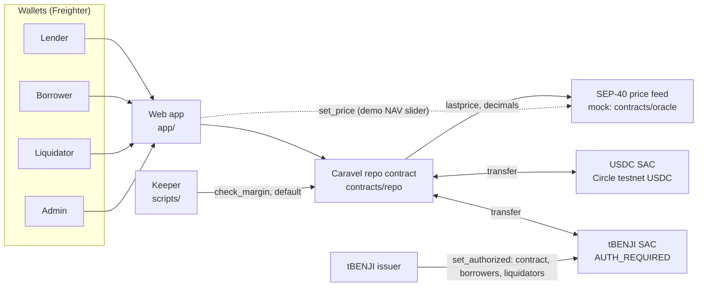
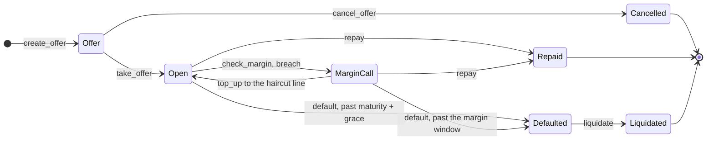

<p align="center"></p>

# Caravel

**On-chain term repo for tokenized Treasuries on Stellar.**
Fixed-term, fixed-rate USDC loans against tokenized money-market funds, priced off daily NAV, settled with atomic DvP.

> DeFi tries to liquidate Treasuries at 3 a.m. on a Sunday. TradFi never does that. It does repo.

Built at HackMeridian 2026 (Lisbon, 25–26 Oct) · Genesis path · Stellar Unlocked + Stellar Composed.

<!-- REVIEW (Bohdan Koldun): drop this WIP line before submission. -->
> 🚧 Work in progress during the hackathon. New to the team? Start with [INTRO.md](INTRO.md) · Team board: [TASKS.md](TASKS.md) · Who does what: [DEVS.md](DEVS.md) · Locked decisions: [DECISIONS.md](DECISIONS.md) · Design system: [design/](design/README.md) · Landing page: [site/](site/README.md) · App: [app/](app/README.md) · Collateral research (sourced numbers for Problem/Insight/Risks): [docs/collateral-research.md](docs/collateral-research.md)

## Problem

Stellar holds billions in tokenized fund shares that no on-chain lender can hold.

| Fact | Value | Source |
|---|---|---|
| RWAs on Stellar (active market cap, 25 Oct) | **≈$2.4B** | [DefiLlama RWA](https://defillama.com/rwa/chain/stellar) |
| Spiko on Stellar, the largest issuer (eurSAFO $1.47B, EUTBL $272M, USTBL $36M) | **≈$1.78B** | DefiLlama: [eurSAFO](https://defillama.com/rwa/asset/eurSAFO), [EUTBL](https://defillama.com/rwa/asset/EUTBL), [USTBL](https://defillama.com/rwa/asset/USTBL) |
| Franklin BENJI on Stellar ($475M, [DefiLlama](https://defillama.com/rwa/asset/BENJI)) held by any smart contract | **0 contracts** | [Horizon](https://horizon.stellar.org/assets?asset_code=BENJI&asset_issuer=GBHNGLLIE3KWGKCHIKMHJ5HVZHYIK7WTBE4QF5PLAKL4CJGSEU7HZIW5) |
| Spiko markets on Stellar lenders | XOXNO lists six, all disabled | [WhaleHub](https://whalehub.io/blog/spiko-stellar) |
| Largest Stellar lender (Blend V2) | $132M, mostly XLM collateral, no allowlist hook | [gap analysis](docs/research/rwa-collateral-gap-analysis.md) |

A holder of tokenized T-bills who needs dollars for a week has two options today: sell the fund shares and lose the yield, or leave Stellar. The assets are some of the safest on the network, and almost none of them can be borrowed against.

## Insight

The asset is safe; the exit is slow. A tokenized Treasury fund share has a price once a day, turns into cash only on business days, and can be held only by holders the issuer approves ([collateral research §1](docs/collateral-research.md#1-the-lens-every-dollar-token-ends-in-t-bills-and-the-weak-link-is-exit-not-the-asset)).

24/7 DeFi lending fails on all three counts. Between NAV prints there is no new price to react to. A seized share can't be redeemed until the next business day. A permissionless liquidation bot can't even receive the token, because the issuer's AUTH_REQUIRED flag stops it.

Money markets already have a model for this asset: the **repo**. Caravel puts it on-chain. Debt is fixed up front, margin is checked against daily NAV, the borrower gets a window to post more collateral before default, and a default goes to issuer-approved liquidators at NAV minus a fixed discount.

One design fact carries most of the compliance weight: **lenders never hold fund shares.** They put in USDC and get USDC back. Only the contract, borrowers and liquidators need the issuer's approval, the same split [Aave Horizon](https://aave.com/docs/aave-v3/horizon) uses.

## How it works

One repo, end to end: 1,000 USDC for 7 days at 5% APR against tBENJI at NAV 1.00, with a 3% haircut, a 2% liquidation discount and a 10% protocol fee on interest. Amounts are rounded to cents; exact 7-decimal values are in [docs/mechanics.md §6](docs/mechanics.md#6-worked-example) and in the contract tests.

1. **Offer.** The lender posts the offer and the 1,000 USDC moves into the contract right away. Until someone takes it, the lender can cancel and get it back.
2. **Take (DvP).** The borrower takes the whole offer. In one transaction the contract pulls **1,031.92 tBENJI** from the borrower and pays out **1,000 USDC**. Debt is fixed at **1,000.96 USDC** (principal + full-term interest). Either both legs settle or neither does. The contract computes the collateral itself, and the borrower's signature pins the exact amount, so a NAV move between preview and submit fails the transaction instead of overcharging.
3. **Margin.** Anyone (in practice our keeper) can call `check_margin` against a fresh NAV. If NAV falls about 1% (below roughly 0.9898), the repo goes into **MarginCall** and the borrower has a window to add collateral back to the 3% haircut line. At NAV 0.985 that is 15.71 more tBENJI.
4. **Repay.** At or before maturity the borrower pays 1,000.96 USDC and gets all collateral back. The lender receives **1,000.86** (4.50% net APR) and the protocol fee is **0.10**. Repaying early costs the same: the debt is fixed at take. With **auto-repay** on (the app's default), the same signature that takes the offer lets the contract pull the 1,000.96 USDC at maturity, so a borrower who forgets to press Repay still gets the collateral back as long as the USDC is in the wallet.
5. **Default.** If the borrower hasn't repaid by maturity plus grace, or misses the margin deadline, anyone can mark the repo **Defaulted**. No price is needed for this step. For an auto-repay repo, `default` first tries to pull the debt and settles as Repaid if it can; only a borrower who is short of USDC defaults.
6. **Liquidation.** A whitelisted, issuer-approved liquidator buys all the collateral at NAV − 2%: **1,011.28 USDC** at NAV 1.00. The proceeds pay the lender's terms first, then the fee, then the surplus to the borrower (**10.32**). If proceeds fall short of the lender's terms, the lender takes everything and a `Shortfall` event records the gap on-chain.

In the demo, **1 day = 60 seconds**, so the 7-day repo matures in 7 minutes. That is configuration only: interest uses a 365-day year of the configured day length, so the demo accrues the same coupon as a real 7-day repo.

## Architecture



- **Repo contract** ([contracts/repo](contracts/repo/src/lib.rs)): holds offers, escrow and collateral; runs every flow. All arithmetic lives in one module, [math.rs](contracts/repo/src/math.rs), with its own tests. NAV is read only through [oracle.rs](contracts/repo/src/oracle.rs), which enforces the staleness rule.
- **Token contracts (SAC):** USDC and tBENJI are classic Stellar assets. The contract moves them through their Stellar Asset Contracts, so balances stay visible in any Stellar wallet.
- **Price feed:** a mock of the SEP-40 interface Reflector uses (same `Asset` and `PriceData` shapes, 14 decimals). Pointing the contract at a live SEP-40 feed is a config change, not a code change.
- **Keeper:** an off-chain script that calls `check_margin` on open repos and `default` once a deadline passes. Both calls are permissionless; the keeper has no special rights.
- **Web app:** lender, borrower, liquidator and admin views on testnet, built on generated TypeScript bindings.
- **Issuer:** authorizes the repo contract, each borrower and each liquidator on tBENJI. This is the compliance layer; Caravel does no KYC of its own.

<!-- REVIEW: contracts/oracle, scripts/ and packages/ land with Misha's deploy branch; app/ with Bohdan Che's frontend. Check every path resolves before submission. -->

## Contract spec

### States



1. `take_offer` (borrower): offer → **Open**. Collateral in, USDC out in one atomic transaction. The offer is gone after this.
2. `check_margin` (anyone): Open → **MarginCall** when `debt > collateral × NAV × (1 − 2%)`. Starts the margin window. Blocked on stale NAV.
3. `top_up` (borrower): MarginCall → **Open**, only once collateral is back at the initial haircut. Works with stale NAV.
4. `repay` (borrower): Open or MarginCall → **Repaid** (final). Works with stale NAV, and after maturity until someone calls `default`.
5. `default` (anyone): Open past maturity + grace, or MarginCall past the window → **Defaulted**. Then `liquidate` (whitelisted, fresh NAV): Defaulted → **Liquidated** (final).

### Methods

| Method | Caller | Status change | Fresh NAV | Funds moved |
|---|---|---|---|---|
| `create_offer(lender, collateral_asset, principal, apr_bps, term_secs) → offer_id` | lender | → offer | no | lender USDC → contract |
| `cancel_offer(offer_id)` | the offer's lender | offer removed | no | contract USDC → lender |
| `take_offer(borrower, offer_id, auto_repay) → repo_id` | borrower | offer → Open | **yes** | borrower collateral → contract; contract USDC → borrower; with `auto_repay`, a USDC allowance for the debt |
| `repay(repo_id)` | borrower | Open / MarginCall → Repaid | no | borrower USDC → lender (`P + I − fee`) and treasury (`fee`); collateral → borrower |
| `set_auto_repay(repo_id, enabled)` | borrower | — | no | USDC allowance for the debt granted / withdrawn |
| `auto_repay(repo_id)` | anyone, from maturity or a missed margin deadline | Open / MarginCall → Repaid | no | as `repay`, pulled from the allowance; fails with `AutoRepayFailed` and moves nothing if the borrower is short |
| `top_up(repo_id, amount)` | borrower | MarginCall → Open at the haircut line | no | borrower collateral → contract |
| `check_margin(repo_id) → Status` | anyone | Open → MarginCall on breach; deadline set once | **yes** | none |
| `default(repo_id) → Status` | anyone | Open / MarginCall → Defaulted, or → Repaid for an auto-repay repo whose debt it can pull | no | none, or as `auto_repay` |
| `liquidate(liquidator, repo_id)` | whitelisted liquidator | Defaulted → Liquidated | **yes** | liquidator USDC → lender, treasury, borrower; collateral → liquidator |
| `set_asset(asset, config)` | admin | — | — | — |
| `set_liquidator(who, allowed)` | admin | — | — | — |
| `config()`, `offer(id)`, `repo(id)`, `asset(addr)`, `is_liquidator(who)` | anyone | read only | — | — |

<!-- REVIEW (Misha): check_margin and top_up rows follow DECISIONS #14, #17 and #20; confirm they match margin.rs once it merges. -->

Every state-changing call checks status first and fails with a named error otherwise. An offer can be taken once; a repo can be repaid, defaulted or liquidated once.

### Events

| Event | Topics | Data |
|---|---|---|
| `AssetConfigured` | asset | haircut_bps, enabled |
| `OfferCreated` | offer_id, lender | collateral_asset, principal, apr_bps, term_secs |
| `OfferCancelled` | offer_id, lender | principal |
| `RepoOpened` | repo_id, offer_id | lender, borrower, collateral_asset, collateral_amount, principal, interest, haircut_bps, maturity_ts |
| `MarginCall` | repo_id | deadline |
| `ToppedUp` | repo_id | amount, collateral_amount, cleared |
| `Repaid` | repo_id | lender_amount, fee |
| `Defaulted` | repo_id | — |
| `Liquidated` | repo_id, liquidator | proceeds, lender_amount, fee, borrower_amount |
| `Shortfall` | repo_id | amount the lender is still owed |

### Units and rounding

Amounts are `i128` in 7-decimal Stellar units. NAV is scaled by the feed's `decimals()`, read on every call. Every rounding goes the lender's way: interest and required collateral round up, collateral value rounds down, liquidation proceeds round up, and the fee rounds down so the lender keeps the dust.

### Rules the tests hold

- **The lender never gets more than the offer terms**, and on repay gets exactly `principal + interest − fee`.
- **No one-legged settlement.** USDC leaves escrow only in the same transaction the collateral arrives.
- **Debt is fixed at take.** Early repay pays the same amount.
- **The haircut is snapshotted at take.** Re-tiering an asset changes new takes only.
- **No action on an old price.** `take_offer`, `check_margin` and `liquidate` fail on stale NAV; `repay` and `top_up` never read it, so a borrower can always exit.
- **A disabled asset stops new offers and takes, not live repos.** Repay and liquidation still work.

`cargo test` runs 85 contract tests, including the three liquidation outcomes (surplus, lender made whole, shortfall) checked to the stroop.

### Parameters

All durations are configuration, so the demo compresses time without touching contract logic.

| Parameter | Scope | Demo | Production intent |
|---|---|---|---|
| `day_secs` | global | 60 | 86,400 |
| `term_secs` | per offer | 420 (7 demo days) | lender's choice, 7–30 days |
| `apr_bps` | per offer | 500 | lender's choice; quoted as a spread over T-bills (3.87%) |
| `haircut_bps` | per asset | 300 (tBENJI) | USTBL/BENJI/USDY 300, EUTBL ≈500, CETES 800–1000 ([DECISIONS #26](DECISIONS.md)) |
| `liquidation_discount_bps` | global | 200 | must stay below every haircut; the contract enforces it |
| `margin_window_secs` | global | 120 (2 demo days) | 3 days, so a Friday call survives to Monday's NAV |
| `grace_secs` | global | 60 (1 demo day) | 1 day |
| `max_nav_age_secs` | global | 180 (3 demo days) | 5 days, to cover a long weekend |
| `fee_bps` | global | 1,000 (10% of interest) | illustrative |

<!-- REVIEW (team): production values follow docs/mechanics.md §7 and are intent, not decisions. Confirm or cut. -->

## Stellar features used

- **Authorized trustlines (AUTH_REQUIRED, AUTH_REVOCABLE, AUTH_CLAWBACK_ENABLED).** tBENJI is issued like a real fund share. Our spike proved an issuer can authorize a *contract* as a holder with `set_authorized`, and that freezing it works ([spikes/auth](spikes/auth/README.md)). This is the compliance layer: the issuer, not Caravel, decides who may hold the collateral.
- **Stellar Asset Contracts.** The repo contract moves classic USDC and tBENJI through their SACs. No wrapped tokens.
- **Atomic DvP through Soroban authorization.** The borrower signs one `take_offer` call; the nested tBENJI transfer is part of the same signed authorization, at the exact collateral amount. Both legs settle in one transaction or not at all.
- **SEP-40 price feeds.** The contract speaks the SEP-40 interface Reflector uses, so a mock feed and a live one are interchangeable by config.
- **Real Circle testnet USDC**, not a mock token.
- **Contract events** for every flow, so the app and the keeper index history without extra storage.
- **Storage TTL management.** Config and asset settings live in instance storage; offers, repos and the liquidator list in persistent storage, with the TTL extended on every touch so a live repo is never archived mid-term.

<!-- REVIEW (Misha): add the live Reflector/RedStone read here once G3 lands. -->

## Run it

Prerequisites: Rust with the `wasm32v1-none` target and the Stellar CLI 28.x.

```bash
rustup target add wasm32v1-none
```

Run the contract tests:

```bash
cargo test
```

Build the contract wasm:

```bash
stellar contract build
```

Deploy to testnet (oracle + repo, tBENJI config, liquidator whitelist, issuer authorization, IDs written to `.env` and `deployments/testnet.json`). The testnet burner keys are committed in `.env`.

```bash
scripts/deploy.sh
```

<!-- REVIEW (Misha): deploy.sh lands with misha/deploy-v0. Add the keeper, the seed/reset script and the NAV setter here. -->
<!-- REVIEW (Bohdan Che): add the app's install and run commands here. -->

## Testnet deployment

| Contract | ID |
|---|---|
| Repo | _final deploy, Mon 06:00_ |
| Price feed (mock SEP-40) | _final deploy, Mon 06:00_ |
| USDC SAC (Circle testnet USDC) | [`CBIELTK6YBZJU5UP2WWQEUCYKLPU6AUNZ2BQ4WWFEIE3USCIHMXQDAMA`](https://stellar.expert/explorer/testnet/contract/CBIELTK6YBZJU5UP2WWQEUCYKLPU6AUNZ2BQ4WWFEIE3USCIHMXQDAMA) |
| tBENJI SAC (AUTH_REQUIRED) | [`CBC7SGLXRLNFXK5S33XL7PQ2YBT3NMT5W5EOW5PLOMLIIGBNGACKXBXX`](https://stellar.expert/explorer/testnet/contract/CBC7SGLXRLNFXK5S33XL7PQ2YBT3NMT5W5EOW5PLOMLIIGBNGACKXBXX) |

<!-- REVIEW (Misha): fill repo and oracle IDs after the final deploy, plus a stellar.expert link to one take_offer DvP transaction. -->

## Risks and limits

- **Shortfall.** The margin call fires while a liquidation would still pay the lender in full, about a 1% NAV fall at maximum LTV. If NAV keeps falling during the margin window and the borrower doesn't top up, the lender takes the loss. At NAV 0.97 the lender gets 980.94 of the 1,000.86 owed, and a `Shortfall` event records the 19.92 gap. There is no insurance fund yet. For a stable-$1 money-market fund a 1% fall means the fund broke the buck, which is the event the margin check guards against.
- **Issuer dependence.** The design rests on the fund issuer authorizing the contract as a holder of record. No contract holds BENJI today; our testnet runs on a team-issued tBENJI. A freeze, clawback or de-authorization by the issuer stops repay and liquidation, and the haircut doesn't cover that.
- **Negative carry.** A passive holder pays 5% to borrow against a fund yielding 3.87%. Caravel's target borrower is a trader or market maker whose USDC earns more than the repo costs. The lender earns 4.50% net: more than T-bills, less than a variable-rate USDC pool (6.69% on Blend), in exchange for a fixed term, a fixed rate and T-bill collateral.
- **Dividends.** Real BENJI pays its yield as new tokens to the holder of record, which during a repo is the contract. Passing them back to the borrower is on the roadmap; the demo token pays none.
- **Liquidators.** Liquidators must be issuer-approved, and nothing obliges one to buy, so a defaulted repo can wait. A liquidation sells all the collateral, so defaulting at NAV 1.00 costs the borrower about 21.60 USDC per 1,000 against 0.96 of interest for repaying. Once a repo is Defaulted the borrower can no longer repay.
- **One admin key.** The admin sets the asset list and the liquidator whitelist, and the feed is only as good as whoever writes it. A wrong but fresh price plus a friendly liquidator could cost the lender principal. Target: split keys and a timelock.
- **Push payouts.** Repay and liquidation pay lender, treasury and borrower directly. An account that removes its USDC trustline can make those payments fail. Target: hold payouts in the contract for each party to claim.
- **Staleness means feed liveness.** The rule catches a feed that stopped updating, not a fund that stopped publishing.
- **Regulatory scope.** This is a testnet demo, not a public offer. Tokenized fund shares are financial instruments and USDC is an e-money token under MiCA; a live deployment needs a legal analysis per issuer and jurisdiction.

<!-- REVIEW (team): docs/mechanics.md §14 proposes an earlier margin trigger (2.5%) that would leave a cushion between the call and any lender loss. If the team adopts it before freeze, rewrite the Shortfall bullet; if not, it stays as written. -->

**Roadmap:** dividend pass-through; claimable payouts; repay out of Defaulted with a short liquidation delay; sell only enough collateral to cover the debt; per-asset NAV bounds; split admin keys; a live Reflector or RedStone feed; Spiko USTBL as the second asset; passkey smart wallets.

## Built during HackMeridian

Everything in this repo was written during the hackathon, starting around noon on Sun 25 Oct 2026. The git log is the record.

- **Sun 12:00–13:15:** README skeleton, task board and locked decisions; AUTH_REQUIRED spike on testnet (**GO**); testnet accounts funded with real Circle USDC; collateral research.
- **Sun 13:15–14:10:** repo contract skeleton and `math.rs`; decisions 13–22 (per-asset haircut, margin trigger, fixed debt, full takes); design system and logo.
- **Sun 14:10–14:30:** protocol mechanics v2 after an [adversarial design review](docs/design-review.md) (nine standpoints, 48 findings); SEP-40 NAV client; `create_offer`, `cancel_offer`, `take_offer`, `repay`, `default`, `liquidate` with 85 tests.

<!-- REVIEW (Bohdan Koldun): extend through Monday: mock oracle, deploy, margin call, keeper, app, video. -->

## Team

| Name | Role | GitHub |
|---|---|---|
| Denys Nichoha | Contracts: core flows | _TODO_ |
| Misha | Integration: oracle, margin, keeper, deploy | _TODO_ |
| Bohdan Chernenko | Design + frontend | _TODO_ |
| Bohdan Koldun | Pitch, docs, QA | _TODO_ |

<!-- REVIEW (all): add surnames and handles. -->
